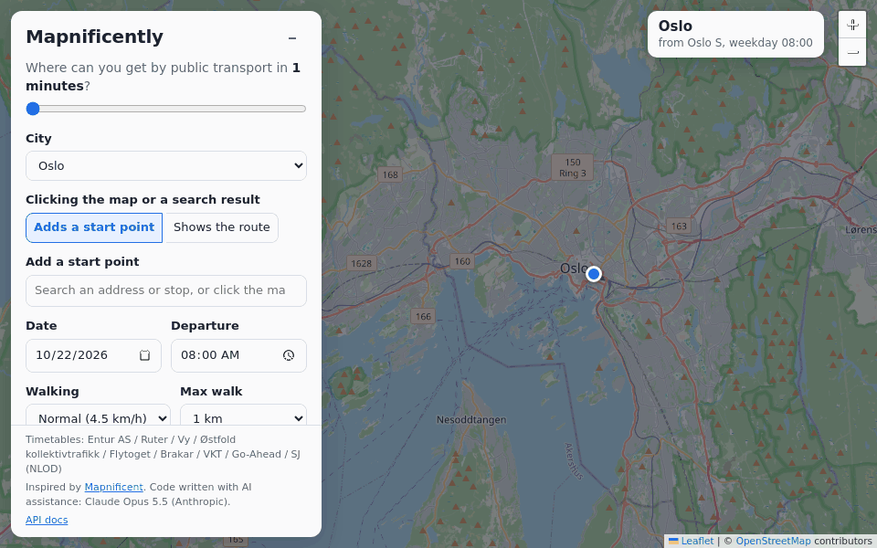
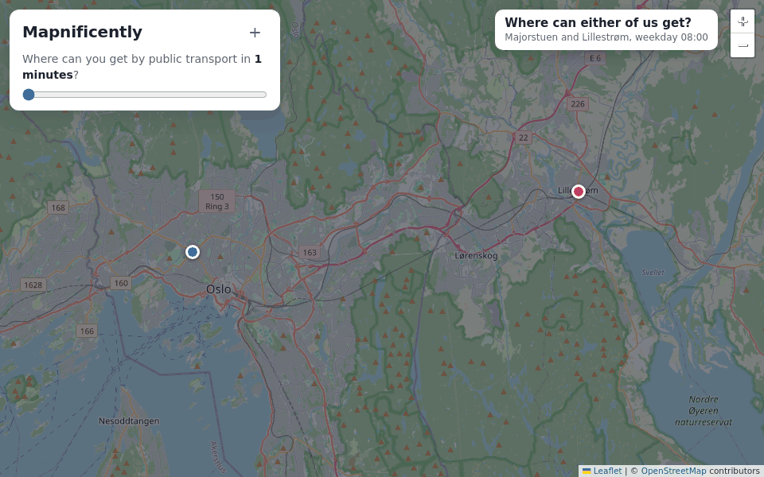
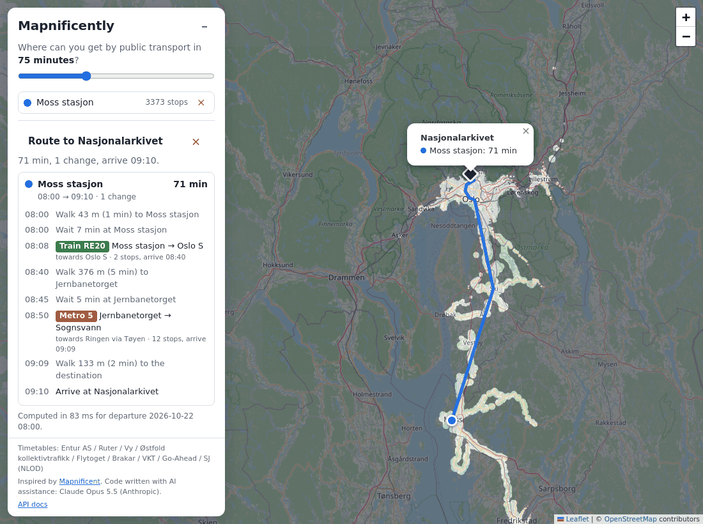

# Mapnificently

[](https://github.com/Patechoc/mapnificently/actions/workflows/ci.yml)

[](https://deploy.cloud.run/?git_repo=https://github.com/Patechoc/mapnificently.git) *your own copy, with the data of every city included ([details](#run-it-on-google-cloud-cloud-run))*

Where can you get by public transport in a given time?

Mapnificently is a Python take on the original [Mapnificent](https://www.mapnificent.net/),
created by [Stefan Wehrmeyer (stefanw)](https://github.com/stefanw) 🤩

Pick a city, click one or more start points on the map and drag the time slider.
Everything you can reach by transit plus walking stays clear,
and the rest of the map is greyed out.



*From the main station of Oslo, Bergen and Trondheim at 08:00 on a weekday, each frame adds one
minute of travel time. The area grows in fingers along the metro, tram and train lines, and in
circles around each stop: the walk you still have time for. Halfway through each city the
settings panel is collapsed, keeping only the time slider.*

- **Web map** (Leaflet), served by the API:
  - several start points
  - "where anyone can get" (union) or "where everyone can get" (intersection)
  - a slider that redraws instantly
  - address search
  - routes: click a destination to see the fastest journey from each start point, with every
    walk, wait and ride, drawn on the map
  - a minimum change time between vehicles (2 minutes by default)
  - shareable URLs
- **HTTP API** (FastAPI, OpenAPI docs at `/docs`)
- **CLI** (click) for the API and for managing data
- **Pluggable data providers**: a city with a GTFS feed takes one config block

Configured cities: **Oslo and Moss** (sharing the **Oslofjord** region: Oslo, Akershus, Østfold,
Drammen and Vestfold, with Ruter, Vy, Østfold kollektivtrafikk, Flytoget, Brakar, VKT, Go-Ahead
and SJ), **Bergen** and **Trondheim**. Their data comes from
[Entur](https://developer.entur.org/), Norway's national journey planner, under the NLOD licence.

## What you can do with it

**Where can we meet?** Add a start point for each person. "Where anyone can get" shows
everything at least one of you reaches in time; "where everyone can get" keeps only the places
all of you reach: the possible meeting points.



*Majorstuen and Lillestrøm, 08:00: first where either person can get, then the meeting area,
which appears near Oslo S after about 20 minutes and grows from there.*

**How do I get there?** Switch clicks to "Shows the route" and pick a place: the panel lists
every walk, wait and ride for each start point, and the map draws the route.



*Moss stasjon → Helsfyr, Oslo, at 08:00 on a weekday: RE20 to Oslo S, a 5-minute walk to
Jernbanetorget, then metro 3 to Helsfyr: 52 minutes with one change.*

## Quick start

```bash
make install                      # uv sync --all-extras
make data-fetch CITY=trondheim    # ~40 MB, a few seconds
make data-fetch-all               # every region, ~310 MB on disk, under 20 s
make serve                        # http://127.0.0.1:8000
```

Open http://127.0.0.1:8000, click the map and move the slider.

Run `make` on its own to list every target, grouped into Setup, Quality, Tests, Data, Run,
Queries and Housekeeping. Variables are set on the command line:

```bash
make reach CITY=moss FROM="Moss stasjon" AT=2026-10-22T07:30 MINUTES=45
make isochrone FROM="Majorstuen;Oslo lufthavn" MINUTES=60 MODE=intersection OUT=meet.geojson
make route CITY=moss FROM="Moss stasjon;Rygge stasjon" TO="Oslo S" CHANGE=3
make check                        # lint, format check, mypy and tests
```

Separate several start points in `FROM` with `;`. The query targets use a server started with
`make serve` when one is running, and otherwise answer locally. (`make static-serve` serves
only the static site, which has no API.)

## Run it on Google Cloud (Cloud Run)

[](https://deploy.cloud.run/?git_repo=https://github.com/Patechoc/mapnificently.git)

The button builds this repository's `Dockerfile` and deploys it to Cloud Run **in your own
Google Cloud project, billed to you** (a demo that sleeps when idle costs little). The image
contains the prepared data of every configured region, so the app is ready as soon as it
starts. A deployment keeps the image it was built with: deploy again to refresh the timetables
or to pick up fixes.

**[docs/cloud-run.md](docs/cloud-run.md)** covers the rest:

- running the `gcloud` commands in Cloud Shell (browser) or in your own terminal (WSL included)
- deploying without the button, and what to do if the button fails
- updating a running deployment
- costs, making it private, removing it
- testing the container locally (`make docker-test`)

## CLI

`serve` and `data` run locally. The other commands call the API (`--api-url`, or
`MAPNIFICENTLY_API_URL`, default `http://127.0.0.1:8000`); when no server answers there, they
run the same app in-process on the local data and say so, so no server is needed. A `--from` can be `lat,lon` or a place
name, which is looked up with the city's geocoder.

```bash
mapnificently data status                      # which cities have data, service dates
mapnificently cities
mapnificently geocode moss "Moss stasjon"
mapnificently reach moss --from "Moss stasjon" --at 2026-10-22T07:30 --minutes 45
mapnificently isochrone oslo --from Jernbanetorget --minutes 30 -o oslo-30.geojson
mapnificently isochrone oslo --from Majorstuen --from "Oslo lufthavn" \
    --minutes 60 --mode intersection -o meet.geojson
mapnificently route moss --from "Moss stasjon" --from "Rygge stasjon" --to "Oslo S" --at 08:00
```

Every query takes `--min-change` (minutes needed to change between vehicles, default 2),
`--walk-speed` and `--max-walk`. `route` prints each journey leg by leg:

```
From Moss stasjon, Moss to Oslo S, Oslo: 42 min, 0 changes, arrive 08:41
  08:00-08:00  walk 44 m to Moss stasjon
  08:08-08:40  rail RE20 towards Oslo S: Moss stasjon → Oslo S (2 stops)   (wait 7 min)
  08:40-08:41  walk 116 m to Oslo S, Oslo
```

The GeoJSON output can be opened in QGIS or on [geojson.io](https://geojson.io).

## API

| Method | Path | What |
|---|---|---|
| GET | `/api/config` | Limits the web map adapts to (longest travel time) |
| GET | `/api/cities` | Configured cities and whether their data is ready |
| GET | `/api/cities/{city}/status` | Feeds, number of stops and trips, service dates |
| POST | `/api/cities/{city}/refresh` | Re-download and rebuild the data, in the background |
| GET | `/api/cities/{city}/stops` | All stops, as parallel arrays |
| GET | `/api/cities/{city}/geocode?q=` | Address and stop search |
| POST | `/api/cities/{city}/reach` | Earliest arrival at every reachable stop, per origin |
| POST | `/api/cities/{city}/isochrone` | Reachable area as GeoJSON (union or intersection) |
| POST | `/api/cities/{city}/route` | Fastest journey from each origin to a destination, leg by leg |

A departure without a timezone is read in the city's local time. Errors are `404` for an unknown
city, `409` when the city's data hasn't been fetched yet, and `422` for an invalid request.

## How it works

```
GTFS zips ─▶ providers/  download, skip unchanged (ETag / Last-Modified)
          ─▶ gtfs/       polars: keep stops in the city bbox, merge feeds, write Parquet
          ─▶ timetable/  one service day = vehicle hops sorted by departure (cached .npz)
                         + walking links between stops less than 400 m apart
          ─▶ routing/    Connection Scan Algorithm: earliest arrival at every stop
          ─▶ isochrone/  circle of remaining walking time around each stop, union / intersection
```

This is the original Mapnificent model. Around a stop you reach after `t` minutes, you can still
walk for `T − t` minutes, so the reachable area is the union of those circles. Walking distance
is taken as 1.2 × the straight-line distance. The web map draws the circles itself from the
`/reach` response, so moving the slider doesn't need a new request.

### Changes between vehicles

The router keeps two times for every stop: when you **arrive** there (what the map shows), and
when you are **ready to board** there. Changing from one vehicle to another takes at least the
minimum change time (2 minutes by default, 0–15), or the walk to another stop if that is longer.
Staying on the same vehicle needs no change time, and neither does your first boarding after
walking from the start point. Waiting is included automatically: all times are clock times,
so you simply take the first vehicle that leaves after you are ready.

### Routes

While scanning, the router remembers how it reached every stop: which vehicle, where you
boarded it, and any walk after getting off. To answer a route query it picks the quickest way
to the destination (walk all the way, or ride to a stop near it and walk) and follows those
records back to the start. Each leg has its mode, line, direction, stops, times, and the
waiting before it. Where a vehicle could be boarded at several stops in time, the journey uses
the one reached with the fewest vehicles (then the latest), so it shows "walk to
Jernbanetorget and wait for metro 5" rather than an extra one-stop ride to meet metro 5
further on; the arrival time is the same.

With several start points you get one journey per start point, plus two summaries:
`fastest_s`, the quickest journey ("where anyone can get"), and `everyone_s`, when the last
person arrives ("where everyone can get"). `everyone_s` is null when a start point cannot get
there within the time limit.

Typical timings on a laptop:

| Region | Query | Time |
|---|---|---|
| Oslofjord (15,800 stops, about 700k connections a day) | `/reach` with a 120-minute window | about 30 ms |
| Oslofjord | 30-minute `/isochrone` polygon | about 75 ms |

## Regions, cities and stored data

Timetables belong to **regions**: a region is downloaded and prepared once, and a trip can use
every operator in it. **Cities** are named views of a region (where the map opens), so Oslo and
Moss share one copy of the Oslofjord data and give the same answers: Moss stasjon → Sognsvann
(RE20, then the metro) or Moss → Drammen (RE20, then R13) just work.

Downloads are shared too, one folder per provider, so a feed used by several regions (Vy trains
are in both Oslofjord and Bergen) is stored once:

```
~/.cache/mapnificently/
  feeds/entur/vyg.zip, rut.zip, …     downloads, shared by every region
  regions/oslofjord/prepared/         prepared tables and cached timetables of one region
```

```bash
make data-fetch CITY=moss          # fetches Moss's region (oslofjord), for Oslo too
make data-status                   # regions, their cities, dates and disk use
make data-status PATHS=1           # ...and where every file is
make data-prune                    # remove what no region uses (asks first)
make data-clean CITY=bergen        # remove one region and the feeds only it uses (asks first)
```

### Adding a city or region

Most places need no code: a few lines in
[`src/mapnificently/cities.toml`](src/mapnificently/cities.toml) (or in your own file, pointed
to by `MAPNIFICENTLY_CITIES_FILE`) that point to the timetables the transport authority already
publishes as GTFS.

**[docs/adding-a-city.md](docs/adding-a-city.md)** walks you through it step by step, with Paris
as the worked example: finding a country's timetables, checking them, drawing the region,
writing the configuration, testing the results and keeping them up to date.

## Adding a provider

A provider decides how a city's GTFS is obtained and, optionally, how places are searched:

```python
from mapnificently.providers import TransitProvider

class MyCityProvider(TransitProvider):
    def fetch_feeds(self, city, dest_dir, *, force=False):
        ...  # write GTFS zip(s) into dest_dir and return their paths

    def geocode(self, city, text, limit=8):
        ...  # optional: return a list of mapnificently.models.Place
```

There are two ways to register a provider:
- Add it to `BUILTIN_PROVIDERS` in `providers/registry.py`.
- In a separate package, declare an entry point. Cities then use `provider = "mycity"`.

  ```toml
  [project.entry-points."mapnificently.providers"]
  mycity = "my_package.providers:MyCityProvider"
  ```

If a source has no GTFS, for example a REST API, its provider converts the data to GTFS files
inside `fetch_feeds`, and the rest of the pipeline stays the same.

## Offline use and static hosting (GitHub Pages)

`make static` exports a copy of the web map that needs no server: routing runs in the browser
(`web/offline.js`, a port of the Python router that gives identical results), on timetables
exported for a fixed number of days.

```bash
make static CITIES="moss oslo" DAYS=7    # writes site/: the Oslofjord region once, ~13 MB per day
make static-serve                        # http://127.0.0.1:8080, like GitHub Pages would serve it
```

After the first visit, a service worker keeps the page working offline:

| | Offline? |
|---|---|
| Page, Leaflet (bundled), reachable areas, routes | ✅ |
| Search | Online: addresses and places, from the browser (Entur, or Photon outside Norway). Offline: stop names only |
| Timetables | ✅ for days you have already opened; only the exported days exist |
| Map background | ✅ for areas you have already viewed (tiles are kept as you browse, never bulk-downloaded, per the OpenStreetMap tile policy) |

Online searches go from the visitor's browser straight to Entur (or Photon), identified by
`MAPNIFICENTLY_ENTUR_CLIENT_NAME` as set when exporting.

To publish on GitHub Pages, put the contents of `site/` on the branch or folder Pages serves
(e.g. a `gh-pages` branch), and export again regularly: the exported days move on.

> Publishing makes AI-generated code and content public. Within Norwegian Red Cross, check
> with AI-ansvarlig first (the AI rules on responsibility, review and openness about AI use
> apply). The page states that the code was written with AI assistance (Claude Opus 5.5 by
> Anthropic), and the timetable data is open (NLOD, attribution shown).

The server version works offline too, except for address search (Entur/Photon online) and map
tiles not yet viewed. Set `UV_OFFLINE=1` so `uv run`/`make` never try to download.

## Configuration

Settings are read from environment variables or a `.env` file:

| Variable | Default | |
|---|---|---|
| `MAPNIFICENTLY_DATA_DIR` | `~/.cache/mapnificently` | Downloaded feeds and prepared data |
| `MAPNIFICENTLY_CITIES_FILE` | – | Extra cities, or overrides of packaged ones |
| `MAPNIFICENTLY_ENTUR_CLIENT_NAME` | `mapnificently-dev` | Sent to Entur as `ET-Client-Name`. Use `<organisation>-<application>`, never a personal email |
| `MAPNIFICENTLY_API_URL` | `http://127.0.0.1:8000` | Used by the CLI |
| `MAPNIFICENTLY_ALLOW_REFRESH` | `true` | Allow `POST /api/cities/{city}/refresh` (`false` in the Docker image) |
| `PORT` | `8000` | Port of `mapnificently serve` (set by Cloud Run; `8080` in the Docker image) |

## Known limitations

- **Timetables only.** Real-time delays and cancellations are ignored.
- **No ferry to Horten from Moss.** The Moss–Horten ferry is not in the `ost` or `vyg` feeds.
- **One change time for every stop.** The minimum change time is the same everywhere; a
  feed's own `transfers.txt` is not used.
- **Straight ride lines.** Routes are drawn as straight lines between the stops a vehicle
  serves, because `shapes.txt` is not read.
- **Approximate walking.** Distances are straight lines × 1.2, not routed along streets. Water and
  motorways are not taken into account.
- **Region edges.** Trips only use the operators and area of the city's region; a destination
  outside it (e.g. Hamar from Oslo) is reported as outside the area. Extend the region to go
  further. The Moss–Horten ferry is in none of the configured feeds.
- **Shared tile server.** The web map uses the public OpenStreetMap tiles. Before publishing
  widely, switch to a tile provider that allows that traffic.

## Development

```bash
make install            # uv sync --all-extras
make test               # unit tests on a synthetic GTFS feed
make test-integration   # also downloads real Entur data (~40 MB)
make coverage           # coverage report, HTML in htmlcov/
make lint format typecheck
make check              # everything CI should run
make dev                # server with auto-reload
```

### README images

The GIFs and the screenshot in `docs/media/` are recorded from the running app, so they can be
redone whenever the app or the data changes:

```bash
make readme-media      # starts its own server, records with Chromium, writes docs/media/
```

It needs the Oslofjord, Bergen and Trondheim data (`make data-fetch-all`) and Chromium for
Playwright (the target prints the install command if it is missing). The GIFs stay small
because frames share one palette and only store the pixels that changed.

### Continuous integration

`.github/workflows/ci.yml` runs on every push to `main` and every pull request:

| Job | What |
|---|---|
| Quality | all pre-commit hooks (ruff, format, mypy, bandit, detect-secrets, file checks) |
| Tests | the unit tests with coverage on Python 3.12, 3.13 and 3.14 |
| Security | bandit and pip-audit on the locked dependencies (also weekly, for new advisories) |
| Integration | the tests on real Entur data: weekly and on demand (Actions → CI → Run workflow) |
| Docker | builds the image and smoke-tests it (`make docker-test`): on `main`, weekly and on demand |

Dependabot (`.github/dependabot.yml`) opens weekly PRs when GitHub Actions or the Python
dependencies in `uv.lock` have new versions (minor and patch updates grouped, major updates
separately); the CI checks each of them.

Set the repository variable `ENTUR_CLIENT_NAME` (Settings → Secrets and variables → Actions →
Variables) to identify the CI to Entur; it defaults to `mapnificently-ci`.

## Licence and data

The code is MIT-licensed and was written with AI assistance from Claude Opus 5.5 by Anthropic
(model id `claude-opus-5-5`), used through Claude Code.
Timetables: © Entur AS and the transport operators, under the
[NLOD](https://data.norge.no/nlod/en/2.0) licence; Île-de-France Mobilités and SNCF Voyageurs,
under the [ODbL](https://opendatacommons.org/licenses/odbl/). Map tiles: © OpenStreetMap
contributors.
